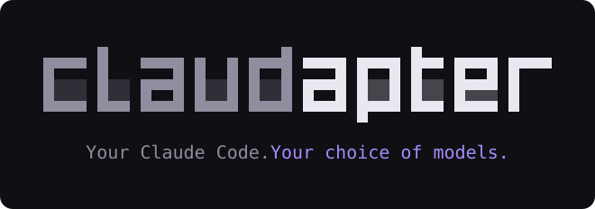
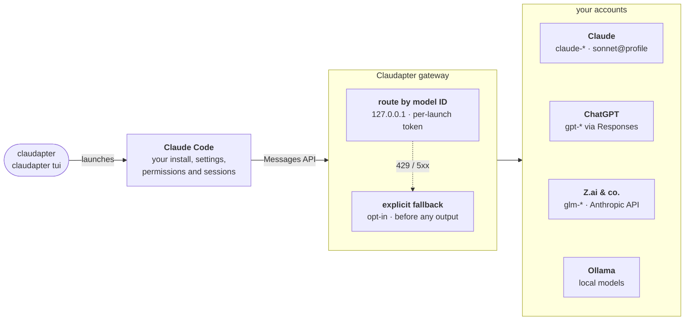

<div align="center">



[](https://github.com/jonax1337/claudapter/releases)
[](LICENSE)
[](https://nodejs.org)
[](https://code.claude.com)
[](#requirements)

[Install](#install) · [Quick start](#quick-start) · [TUI](#the-optional-tui) · [Commands](#commands) · [Configuration](docs/configuration.md) · [Security](#security-model)

</div>

---

Claudapter launches your installed [Claude Code](https://code.claude.com) with a
temporary, loopback-only model gateway. Your normal Claude setup keeps working —
settings, permissions, skills, plugins, MCP servers, hooks and sessions — and the
native `/model` picker gains models from your other accounts.

<table>
<tr>
<td width="50%" valign="top">

### More models, same Claude Code

- **ChatGPT** models from your Codex account catalog, at full catalog context
- **A second Claude account** through profiles — `sonnet@work`
- **Z.ai GLM** and other Anthropic-compatible providers with your own key
- **Local Ollama** models, auto-detected at every launch

</td>
<td width="50%" valign="top">

### Built for control

- **Explicit fallback** — "on a Sonnet rate limit, continue on GLM", off by default
- **GPT-backed native agents** you delegate to by name
- **Provider-aware usage** — tokens counted per actual model, quotas per account
- **Optional TUI** — `claudapter tui`, with the same engine and sessions

</td>
</tr>
</table>

> [!NOTE]
> Claudapter is an independent compatibility tool, not affiliated with or endorsed by
> Anthropic, OpenAI, Z.ai or Ollama. It uses your own subscriptions and keys; staying
> within each provider's terms is your responsibility.
>
> This is a **release candidate** — see [Status and limitations](#status-and-limitations).

## Requirements

| Requirement | Why |
| --- | --- |
| [Node.js](https://nodejs.org) **24** or newer | Runs the launcher and gateway |
| [Claude Code](https://code.claude.com) **2.1.301** or newer | The engine Claudapter launches; 2.1.301 and 2.1.302 are tested |
| [Codex CLI](https://github.com/openai/codex) login (`codex login`) | Only for ChatGPT models; the file-backed login is read, never written |
| [Bun](https://bun.sh) **1.3.14** or newer on `PATH` | Only for `claudapter tui`, and to build from source |

Windows, macOS and Linux are supported by design; day-to-day testing happens on
Windows 11 with PowerShell.

## Install

Claudapter is not published to npm. Install a release tarball from
[GitHub Releases](https://github.com/jonax1337/claudapter/releases):

```sh
npm install --global https://github.com/jonax1337/claudapter/releases/download/v0.2.0-rc.7/claudapter-0.2.0-rc.7.tgz
claudapter setup
claudapter doctor
```

Or build it from source (needs Bun):

```sh
git clone https://github.com/jonax1337/claudapter.git
cd claudapter
npm ci
npm pack
npm install --global ./claudapter-0.2.0-rc.7.tgz
```

Installing adds a `claudapter` command. It does **not** replace `claude`, edit your
shell profile, or rewrite global Claude settings. `claudapter setup` only creates
Claudapter's own configuration under `~/.claudapter`.

Sign in with the official tools if you have not already:

```sh
claude auth login
codex login        # only needed for ChatGPT models
```

## Quick start

Start Claude Code through Claudapter in any project:

```sh
cd path/to/your/project
claudapter                      # native Claude Code, with extra models in /model
claudapter -- --continue        # everything after -- goes to Claude Code
claudapter -- --model gpt-6.1-sol
```

Then open `/model`. Select a row and press **s** to switch for this session only;
**Enter** saves it as Claude's default (choose a Claude model again later if you
want plain `claude` to keep working without Claudapter).

See which models your accounts actually offer:

```sh
claudapter models
claudapter providers
```

Model IDs depend on your account catalog — copy them from `claudapter models`
rather than from examples in this README.

## The optional TUI

```sh
claudapter tui
claudapter tui -- --model gpt-6.1-sol --permission-mode default
```

`claudapter tui` opens Claudapter's own terminal interface, built on
[OpenTUI](https://github.com/anomalyco/opentui) and adapted in parts from
[OpenCode](https://github.com/anomalyco/opencode), on top of the same Claude Code
engine, sessions and permissions. Highlights:

- searchable command palette (`ctrl+p`), slash-command completion, prompt history
- model picker with favorites, provider identity and live quota/context panels (`/usage`, `/context`)
- structured diffs, tool rows and Markdown rendering; mouse selection and copy
- sub-agent tabs and a tasks tree (`ctrl+t`) that keep agent output out of the main transcript
- fallback visibility (which model actually answered) and one-key recovery
- `/settings` for default model, per-model reasoning effort and fallback rules — with confirmation before anything is saved
- six contrast-checked themes, `NO_COLOR` and reduced-motion support, optional Vim mode

The plain `claudapter` command always starts the native interface; the TUI is opt-in.
It is a working interface but **not** complete native feature parity — see
[docs/tui.md](docs/tui.md).

## Commands

| Command | Purpose |
| --- | --- |
| `claudapter [-- <claude args>]` | Launch native Claude Code through the gateway |
| `claudapter tui [-- <claude args>]` | Launch the optional TUI |
| `claudapter setup` / `doctor` | Create configuration / diagnose the environment |
| `claudapter models` / `providers` | List routable models and provider readiness |
| `claudapter usage [--refresh] [--json]` | Provider-aware token usage and account quotas |
| `claudapter profile add\|login\|list\|remove\|default <name>` | Manage additional accounts |
| `claudapter --profile <name>\|none` | Launch once under a profile (also for `tui`) |
| `claudapter provider add [zai]` | Add an Anthropic-compatible provider |
| `claudapter agents enable <gpt-model-id>` | Enable GPT-backed native agents |
| `claudapter fallback show` / `reset …` | Inspect or reset explicit fallback state |
| `claudapter sessions` | List launcher runtime IDs (used by `fallback reset`) |

Configuration — profiles, fallback rules, providers, Ollama, context and usage —
is documented in **[docs/configuration.md](docs/configuration.md)**.

## How it works



Every launch starts one gateway bound to `127.0.0.1` on a random port, protected
by a random per-launch token, and one Claude Code child process. Requests are
routed strictly by model ID. Claude models pass through with their native auth;
ChatGPT requests are translated between the Messages and Responses protocols;
compatible providers receive only their own key. A temporary session plugin adds
model/policy context, configured agents and a read-only discovery MCP server. When
Claude Code exits, the gateway closes and temporary files are removed.

Details: [docs/architecture.md](docs/architecture.md).

## Security model

- **Nothing is bypassed.** No permission-bypass flags, no global alias remapping,
  no silent edits to native settings. Native permission prompts stay in charge.
- **Credentials stay with their owners.** Claude and Codex logins are read, never
  written or refreshed by Claudapter; the official CLIs remain the only refreshers.
  Provider keys are referenced by environment-variable name, never stored.
- **Loopback only.** The gateway listens on `127.0.0.1` and checks a 256-bit token
  before doing anything; bodies, frames and turns are size- and time-bounded.
- **Fallback is off by default.** A fallback rule must be written explicitly in
  your user configuration (project files cannot enable one). Enabling a
  cross-provider rule authorizes sending that conversation to the listed targets.
- **No replay after output.** If a response has started streaming, Claudapter never
  splices in another model's answer; recovery needs a new prompt from you.
- **No secrets in logs.** Diagnostics (`CLAUDAPTER_TRACE=1`) contain model IDs,
  scopes and statuses — never conversation bodies or credentials.

Found a vulnerability? See [SECURITY.md](SECURITY.md).

## Status and limitations

Version **0.2.0-rc.7** is a release candidate. The automated suites (Node and Bun)
run against fixture accounts in isolated homes; several flows have additionally
been accepted live on Windows. Not yet accepted live, and therefore not claimed:

- account rotation with a real second Claude account and a real rate limit
- the full TUI interaction set (approvals, resize, resume and interruption during real turns)
- native sandboxing on Windows, external OAuth flows, remote control

Known behavior to be aware of:

- Native **auto** permission mode may call a Claude safety-classifier model; with a
  GPT main model use `--permission-mode default`.
- Account quotas without a provider interface are shown as **unknown**, never zero.
  Dollar costs are not inferred from subscription tokens.
- Ollama reports a model's *trained* context; the server's loaded window
  (`OLLAMA_CONTEXT_LENGTH`) can be smaller and truncates silently.
- Redacted thinking, hosted tools, documents and structured output formats are
  rejected for cross-provider routing rather than approximated.

The private native dialogs used by the TUI are pinned to Claude Code 2.1.301–2.1.302
and Agent SDK 0.3.301 and refuse other versions. Full evidence and open acceptance
items: [docs/internal/verification.md](docs/internal/verification.md).

## Development

```sh
npm ci               # needs Node 24 and Bun on PATH
npm run check        # TypeScript (backend and TUI)
npm test             # build + Node suite
npm run test:tui     # Bun/OpenTUI suite
npm run tui:preview  # run the TUI from source
```

Tests use fixture credentials and disposable homes; they never touch your real
accounts. See [CONTRIBUTING.md](CONTRIBUTING.md) before opening a pull request.

## Documentation

| Document | Contents |
| --- | --- |
| [docs/configuration.md](docs/configuration.md) | Profiles, fallback, providers, Ollama, context and usage |
| [docs/tui.md](docs/tui.md) | TUI controls, surfaces and remaining parity gaps |
| [docs/architecture.md](docs/architecture.md) | Gateway, routing, trust boundaries |
| [docs/demo.md](docs/demo.md) | A reproducible local walkthrough |
| [CHANGELOG.md](CHANGELOG.md) | Release history |
| [docs/internal/](docs/internal/) | Original brief, task tracking and verification evidence |

## License

[MIT](LICENSE) © 2026 Jonas Laux. Third-party attributions (Rookery Agent translator,
OpenCode UI components, OpenTUI, Claude Agent SDK) are listed in
[THIRD_PARTY_NOTICES.md](THIRD_PARTY_NOTICES.md).
