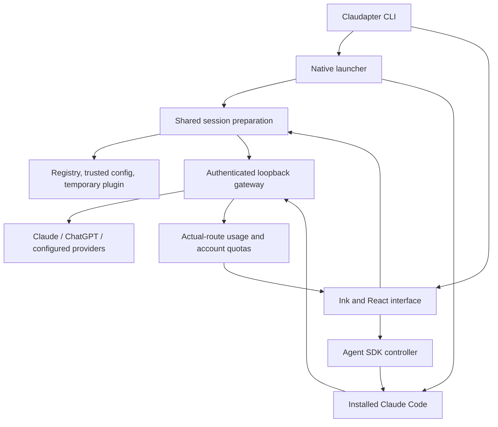

# Optional Claudapter TUI: implemented architecture

Status: implemented for **0.2.0-rc.3**, with incomplete native-feature parity.
The original brief required a native-only interface. The user's subsequent
instruction explicitly adds a custom TUI, maximum model context and correct
provider usage, and permits development subagents for this extension. Native
Claude Code remains the default interface.

This document describes the implementation. Actual test, packed-install and
live results belong in [verification.md](verification.md). An available control
is not evidence that every account or platform supports its underlying service.

## Two interfaces, one execution engine

```text
claudapter                         # native Claude Code interface
claudapter tui                     # optional Claudapter interface
claudapter tui -- --resume <id>     # existing native conversation
claudapter usage --refresh --json   # shared provider-aware report
```



`prepareSession()` in `src/launcher.ts` supplies both modes with the same model
registry, gateway, temporary settings and discovery/agent plugin. The pinned
Agent SDK receives the installed executable path explicitly. No independent tool
runner, retry loop, conversation database or background daemon is introduced.
Native transcripts support session resume, branching and checkpoint operations.

The renderer uses **Ink 8, React 19, @inkjs/ui 2 and string-width**. The native
entry point does not load it. `src/tui/options.ts` translates supported native
arguments, retaining explicit tools, agents, plugins, MCP servers and settings
sources. Ambiguous unknown flags and transport conflicts fail visibly.

User/project/local configuration remains native input; managed policy stays
authoritative. Permission bypass is never added implicitly. Additional native
methods live in `src/tui/compat.ts`, guarded by verified SDK/CLI versions and
response shapes. Native compatibility targets **SDK 0.3.301 / Claude 2.1.301**.

## Implemented interface

- Streaming transcript, optional reasoning summaries, tool inputs/results,
  scrolling, multiline Unicode editing, prompt recall, attachments and copy.
- Session-only model selection, favorites, catalog refresh, explicit native
  agent delegation/follow-up, background-task inspection/output/stop and fallback.
- Resume, clear, rename, fork, Markdown export, checkpoint previews and file
  restoration or conversation branching.
- Own settings, permissions, MCP, plugins, skills, hooks, memory, diagnostics and
  authentication dialogs. Persistent changes identify scope and require confirmation.
- Plan/effort, sandbox, browser selection and Remote Control entry points,
  subject to native compatibility and account/platform restrictions.

Dialogs stay in Claudapter. Native subprocesses and SDK methods perform supported
operations; an unfinished dialog is not handed to the interactive native TUI.
Unsupported commands fail rather than becoming accidental model prompts.

| Theme | Accent | Intent |
| --- | --- | --- |
| Midnight | `#A78BFA` | Default violet palette |
| Ocean | `#38BDF8` | Cyan palette |
| Terminal | ANSI cyan | Follow terminal colors |
| Contrast | ANSI yellow | Strong foreground contrast |

Preferences are saved atomically in Claudapter's `ui.json`. Older files retain
appearance/favorites and acquire missing shortcut defaults. `/keybindings`
accepts Ctrl/Alt combinations and function keys; approval navigation, Ctrl+C and
terminal aliases for Tab/Enter/newline stay reserved. Function keys need a bounded
raw-input listener because Ink's ordinary input callback loses their identity.
Terminal-specific key availability still needs interactive verification.

## Permission and lifecycle boundaries

`TuiController` owns input, model changes, interruption and decisions keyed by
request ID. Redelivery shares one pending decision; abort or shutdown cancels it.
Tool dialogs show arguments and optional session allow rules. AskUserQuestion
supports listed/custom answers, and MCP elicitation supports typed fields and
browser acknowledgements. Missing optional values are omitted, malformed supplied
values fail, and arbitrary question/property names remain data.

Untrusted workspaces require explicit consent. Declining stops startup. Accepting
uses a minimal native trust handshake without supplied agent prompts, plugins,
MCP servers or settings hooks. Claude Code records trust through its own writer;
Claudapter does not edit `.claude.json`. Generation checks prevent delayed startup
and discovery from resurrecting a closed engine.

Clear/resume discard launch-only session selectors and do not replay the initial
prompt. Stream fragments reconcile with complete messages; repeated tool results
do not duplicate output. These presentation checks complement the gateway's
prohibition on inference replay after response or tool output begins.

## Usage: accounting, quotas and money

The ledger records each upstream attempt against its actual provider/model and
main/agent scope. Cached input is normalized without double counting. Interrupted
or unreported usage remains unknown, and SDK aggregates are not added again.

Account quota snapshots are separate provider-defined windows with source and
freshness. Read-only refresh supports the observed ChatGPT usage interface and
native Claude quota sources. Missing credentials, unsupported responses or a
compatible provider without a quota interface produce unknown/unavailable states,
not zero. Refresh performs no inference or credential rotation.

The CLI reports active gateways and the latest ten saved closed-gateway summaries.
It measures Claudapter traffic, not every account client. Saved summaries contain
counters and routing metadata, not conversation/tool bodies. Monetary values
remain unavailable without authoritative reporting; tokens are not invoices.

Native `/usage` remains native. The combined interface is **TUI `/usage`** or
**`claudapter usage`**, not a replacement injected into Claude's own screen.

## Maximum context and native enforcement

The registry selects valid `max_context_window`, falling back to `context_window`.
Default, maximum, source and freshness remain separate. Compatible-provider
capacities are explicit configuration; recognized Claude capacities remain native.

On 2026-10-16 the local GPT catalog supplied **872,000 tokens** as maximum, with
defaults including 500,000 and 272,000. These are observed account metadata, not
constants in Claudapter. Installed-engine context calculation was verified with
872,000 and 272,000 external-model windows and an unchanged 1,000,000-token native
Claude window in the same session.

Temporary settings combine the external-model ceiling with individual
`autoCompactWindow` entries. No `behavesAs` substitution or disabled compaction
is used. Native per-model windows support 100,000 through 1,000,000 tokens;
capacities that cannot safely coexist in that representation fail explicitly.

TUI `/context` separates engine capacity from catalog maximum. Summary counts use
local estimates and the latest reported usage; cumulative usage is not occupied
context. Output/compaction reserves still apply. Near-capacity generation is not
claimed. Fallback admission remains a conservative UTF-8 byte bound with reserves
and never silently drops history.

Evidence and sources: [context checks](context-evidence.md),
[native model configuration](https://code.claude.com/docs/en/model-config),
[SDK reference](https://code.claude.com/docs/en/agent-sdk/typescript),
[Codex model metadata](https://github.com/openai/codex/blob/main/codex-rs/protocol/src/openai_models.rs).

## Remaining parity and release gates

Full native parity is **not** established. Voice, cloud/teleport, artifacts,
complete IDE onboarding, working-directory changes with renewed trust and
advanced native editor interactions remain incomplete or outside verified coverage.
External OAuth completion, browser-device selection and Remote Control require
live account/browser acceptance beyond fixture responses and available methods.

Keep pure tests, isolated installed-engine checks and live subscription evidence
separate. Near-limit conversations, mixed-size concurrent agents, additional
providers and macOS/Linux terminal behavior must not be called verified without
their own runs. Packaging and testing outside the checkout remain release gates.
Current status is in [TASKS.md](../TASKS.md) and [verification.md](verification.md).
