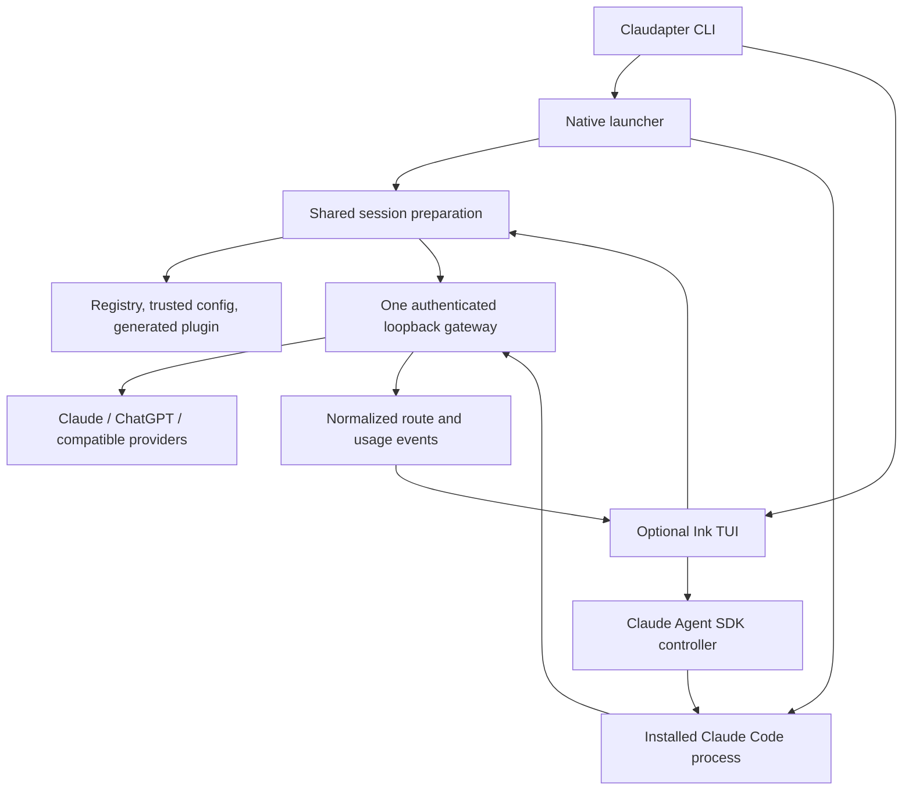

# Optional Claudapter TUI: product and implementation concept

Status: design proposal, not an implemented command. Reviewed against local
0.1.0-rc.1 source and official documentation on 2026-10-16. No UI dependencies,
account integrations, global settings or installed release were changed.

The user's latest request expands the original brief: a custom TUI should be an
option in the first release of this extension. Native Claude Code remains the
default. This document defines that extension; it does not claim native-feature
parity before testing.

## What the current release really knows

| Concern | Current behavior | Evidence |
| --- | --- | --- |
| Native `/usage` | Claude Code owns the screen; Claudapter does not replace it or query quotas for every configured account | `src/gateway.ts`, `src/launcher.ts` |
| Session token usage | GPT response usage is translated into Messages usage. It can contribute to Claude's local session statistics. There is no independent Claudapter usage ledger yet | `src/translate.ts` |
| Account limits | No ChatGPT, compatible-provider or combined quota dashboard is implemented. Claude account bars do not become ChatGPT account bars | Native documentation and gateway routes |
| Costs and attribution | Native dollar estimates are not subscription invoices. A gateway fallback can still be attributed to the requested model in native statistics | Live RC verification |
| GPT context | Registry reads `context_window` from `CODEX_HOME/models_cache.json`; it does not hardcode each GPT model's capacity | `src/models.ts:14` |
| Claude context | Native Claude Code determines its recognized model windows. Claudapter's Claude registry rows currently have no numerical context capacity | `src/models.ts:37`, `src/models.ts:51` |
| Compatible-provider context | User-supplied per model in the trusted Claudapter configuration | `src/config.ts`, `src/cli.ts` |
| Native unknown-model context | Claude Code assumes 200K for unrecognized IDs such as the tested GPT ID; Claudapter does not inject a global window override | Native documentation and RC verification |
| Fallback fit | Current text-size guard uses UTF-8 bytes, requested output reserve (32K when absent) and a fixed 4096 overhead reserve. These reserves are constants, not model context limits. This is conservative admission logic, not exact token counting | `src/fallback.ts:54` |

The locally observed cache, fetched at `2026-10-16T19:27:25.641807200Z`, reports:

| Model | `context_window` used by Claudapter | Separate `max_context_window` field |
| --- | ---: | ---: |
| gpt-6.1-sol | 500,000 | 872,000 |
| gpt-6-astra / gpt-6-sol / gpt-6-luna | 272,000 | 872,000 |

These are a dated catalog observation, not a live near-limit acceptance test.
The current code does not use `max_context_window`. Do not automatically promote
that maximum to an active window or infer account entitlement from it.

## User experience and launch contract

Proposed commands, unavailable in rc.1:

```text
claudapter                          # current native experience, unchanged
claudapter tui                      # new opt-in full chat interface
claudapter tui --resume <session-id>
claudapter usage                     # shared provider-aware metrics, text/JSON
```

The first TUI release includes chat, streaming tool activity, permissions,
model switching, session resume and the model/agent/usage inspector. A settings
dashboard that merely launches the native UI is not the custom-chat deliverable.
Retain one package and dynamically load the TUI entry only when selected. New UI
dependencies will add installation size even though native startup need not load
them. Do not introduce a daemon, second inference loop or second chat database.

Illustrative 110-column layout; values marked unavailable are intentional:

```text
 CLAUDAPTER  /project                         Chat  Models  Agents  Usage
 ----------------------------------------------------------------------
 Requested: GPT-6.1-Sol     Actual: ChatGPT / GPT-6.1-Sol     Fallback: off
 ----------------------------------------------------------------------
 Conversation                                    | Session inspector
                                                 | Catalog window: 500K
 You                                             | Engine window:  200K
 Review this change.                             | Last input: unknown
                                                 | Quota: unavailable
 Assistant                                       |
 I will inspect the diff.                        | Agents
   Read src/example.ts                   done    | gpt-reviewer: idle
                                                 | Delegate on request
 ----------------------------------------------------------------------
 > Write a message; Shift+Enter for another line
 ----------------------------------------------------------------------
 F2 Models   F3 Agents   F4 Usage   F6 Theme   Esc Close   Ctrl+C Interrupt
```

On narrow terminals the inspector becomes a drawer. The transcript owns most
of the screen; output does not jump back to the bottom while the user is reading
earlier messages. Tool cards show pending/running/completed/interrupted states,
with bounded expandable output and explicit permission decisions. Model/provider
changes get a durable timeline entry, including reason and affected agent.

First-release interactions:

- Model selector: filter, recent models, favorites, provider, auth/catalog state,
  tool/vision capabilities and separate catalog/engine context. Switching is
  session-only unless the user explicitly chooses to save a default.
- Agent inspector: actual model, status, latest result and parent. Launch and
  follow-up are explicit user actions through native agent tools. No automatic
  delegation is introduced by opening the panel.
- Fallback editor: off by default; exact targets, scope, error classes, retries,
  timeout and cooldown. Explain which provider will receive conversation data.
  Reset targets one conversation/agent; clearing interrupted-turn protection
  must be deliberate. Do not silently reload broader rules into a live session.
- Permission dialog: tool, exact arguments, target path and allow/deny choices
  with their scope. Handle user questions and MCP elicitation as well. Timeout,
  disconnect or closing the dialog must not approve a pending request.
- Theme picker: preview and explicit persistence in Claudapter's own home;
  never overwrite an existing native Claude theme or status line.

## Library decision and presets

| Candidate | Fit | Decision |
| --- | --- | --- |
| Ink + React | Fits the existing Node/TypeScript package and provides terminal layout/input primitives | First implementation candidate |
| `@inkjs/ui` | Existing inputs, selects, multiselects, spinner, progress, badges and theme provider | Reuse its components; build only chat-specific pieces |
| `ink-testing-library` | Rendering and input assertions | Component verification, supplemented by Windows ConPTY tests |
| OpenTUI + React/Solid | Rich native renderer with textarea, scrollbox, Markdown and diff components | Strong alternative if the Ink transcript/input spike fails; not a second renderer in v1 |

OpenTUI 0.6.6 documents Bun >=1.3.14 or Node >=26.4 with experimental FFI,
plus platform-native artifacts. It supports Windows x64; the concern is the
extra runtime/distribution requirement relative to Claudapter's Node 24 baseline,
not an assertion that OpenTUI cannot run on Windows. Its React package currently
has no dedicated Node CI lane according to its runtime matrix. Recheck these
facts when implementation starts.

Ink UI supplies a component theme, not a finished coding-agent application.
No library supplies Claudapter's permission flow, provider accounting or agent
continuation semantics. Benchmark transcript scrolling and multiline paste
before committing to the renderer. Do not assume a single-line input component
is a complete chat editor.

Proposed Claudapter-owned presets:

| Preset | Accent | Purpose |
| --- | --- | --- |
| Midnight | Violet `#A78BFA` | Default dark interface |
| Ocean | Cyan `#38BDF8` | Cooler dark alternative |
| Terminal | ANSI palette | Respect terminal colors, including light terminals |
| High Contrast | Terminal-aware high contrast | Clear focus and status without relying on color |

Use shared semantic tokens (accent, foreground, muted, border, focus, success,
warning, error, added, removed). Error red remains an error color when the accent
changes. Support no-color, reduced motion, keyboard-only operation and Unicode
cell widths. Start with one conventional layout; avoid configurable layout grids.
A later native-theme exporter can map the same tokens to Claude's supported
theme format without pretending it controls native layout.

## Architecture: two frontends, one execution path



Refactor only the current session preparation/lifecycle out of `launch()` so
both consumers share provider rules, generated agents, environment checks and
cleanup. The native path retains inherited stdio and existing argument behavior.

For the TUI, prefer the official TypeScript Agent SDK to hand-writing the control
protocol. Pin an SDK version tested with the selected installed Claude executable
and explicitly select that executable through `pathToClaudeCodeExecutable`.
The SDK can bundle another Claude binary; distribution and install size must be
tested, and the integration must not silently switch users to that bundled copy.
Preserve native setting sources, cwd, default prompt, plugins, hooks, MCP servers
and permission policy. Explicit user options and managed restrictions still apply.

The current SDK reference documents streaming input, `setModel()`, interruption,
resume, `supportedCommands()` and permission callbacks. Verify each required
method with the pinned version in the compatibility spike. Native interactive
slash-command screens are not automatically portable to an SDK host: implement
TUI `/model`, `/usage`, `/context` and `/theme` as explicit frontend actions and
dispatch only supported remaining commands. Unsupported native-only actions need
a clear message and an idle-session handoff to native mode.

Render structured events, never scrape or recolor Claude's ANSI output. Readonly
UI actions do not call inference. A single controller owns sending a user turn,
interrupting it and answering each permission request by ID. It must not create
another model-retry loop. Gateway fallback remains the only owner when enabled.
Mode handoff requires stopping the current controller before resuming the same
session in the other frontend; no simultaneous writers to one transcript.

## Usage: three different quantities

1. **Session consumption**: provider-reported input/output/cache usage, grouped by
   actual provider/model and main/subagent. Capture from upstream events before
   translating them or allowing native requested-model attribution to obscure it.
2. **Account quota**: provider-specific plan windows, remaining allowance and reset
   time. Show only when an approved authenticated read-only interface actually
   supplies them. Otherwise show `Unavailable`, not zero or an invented percentage.
3. **Money**: subscription status, explicitly reported charges or an identified
   price estimate. Missing prices stay unknown. Tokens times a guessed price are
   not the subscription bill.

Configured providers appear as separate rows even if no statistics are available.
Do not add percentages across providers or equate authentication readiness with
remaining quota. Attach scope, source and fetched-at time to quota snapshots;
cache refreshes and honor rate limits without spending inference to probe them.
An optional ChatGPT quota adapter must first verify the installed Codex upstream
read-only interface and credential behavior. Do not scrape the account UI or
invent endpoints. Unsupported providers remain visible with an explicit unknown.

Add stable request/attempt IDs and reported-usage events to the gateway. Count
each upstream attempt separately and deduplicate its streamed terminal event.
Keep incomplete/no-usage attempts visible as unknown; do not infer zero cost from
an interrupted stream. Normalize cache conventions without double-counting.
Avoid adding a subagent's usage a second time from an SDK aggregate. Begin with
in-memory session accounting; an opt-in JSONL metric history can later retain
non-secret counters, not prompts or tool bodies. Native mode can consume the
same data through a Claudapter-specific command/statusline; its built-in `/usage`
must not be falsely presented as rewritten into a cross-provider dashboard.

## Context: display and enforcement must agree

Track these separately for each active main/agent route:

- Catalog window, source, age and confidence.
- Optional catalog maximum, clearly distinct from an enabled capacity.
- Runtime/engine window actually applied to this scope.
- Input usage reported for the latest completed request, not the sum of every
  request in the conversation. Include cached input in occupied context.
- Pending draft/tool-result estimate, with estimator and uncertainty, if available.
- Output reserve and safety margin.

An initial honest panel can say `Catalog: 500K / Engine: 200K / Last input: ...`.
Increasing the displayed denominator does not change native compaction. A global
`CLAUDE_CODE_MAX_CONTEXT_TOKENS` value cannot correctly represent mixed models and
agents. Never label all unknown models as a known Claude model through `behavesAs`
just to suppress the warning.

Investigate supported per-model runtime mappings in the selected CLI/SDK. If they
cannot be verified for model switching and simultaneous agents, retain the engine
limit, explain the mismatch and disable the promise of full catalog capacity.
The first TUI remains useful with that limitation. Show effective capacity as the
minimum of known enforced constraints; do not turn unknown constraints into an
unlimited window. Compaction remains native until an explicit safe alternative is
implemented. Warn before a smaller-window switch and never silently drop history.
Exact counting, where supported, must use the target provider's schema/tokenizer;
otherwise identify conservative admission checks as estimates.

## First implementation milestones and release gates

1. **Compatibility spike**: SDK with installed CLI, existing sign-ins, preserved
   extensions, denied/approved tool, user question, cancellation, native <-> TUI
   resume, model switching and GPT agent follow-up. No development delegation.
2. **Minimal actual TUI**: streaming chat, multiline composer, tool cards,
   permission/question queue, session lifecycle and two native/TUI entry modes.
3. **Shared observability**: actual-route events, usage normalization and context
   provenance. Unknown quota/cost states are first-class, including empty states.
4. **Daily-use interface**: model/agent/usage drawers, explicit fallback controls,
   theme presets, narrow-terminal behavior and accessible keyboard navigation.
5. **Release evidence**: pack/install outside checkout, no native-mode regression,
   Windows Terminal/PowerShell/ConPTY input and cleanup, and fixture cross-platform
   CI. Render/input tests alone do not establish native-session compatibility.

Critical acceptance: one real edit/test cycle in each UI; Claude -> GPT -> Claude;
permission denial blocks execution; same native GPT agent resumes; simulated 429
changes only its allowed scope; partial output never replays tools; a fallback
does not make usage appear on the wrong provider; missing quotas remain unknown;
500K catalog / 200K runtime is shown honestly; no global config writes from merely
opening the TUI or selecting a temporary theme.

## Sources and unresolved evidence

- [Native usage](https://code.claude.com/docs/en/costs#using-the-usage-command)
- [Native context/window behavior](https://code.claude.com/docs/en/model-config#correct-the-window-for-a-gateway-or-custom-model-id)
- [SDK TypeScript reference](https://code.claude.com/docs/en/agent-sdk/typescript) (the official Markdown endpoint was readable when the rendered reference failed)
- [SDK permissions](https://code.claude.com/docs/en/agent-sdk/permissions)
- [Ink](https://github.com/vadimdemedes/ink), [Ink UI and themes](https://github.com/vadimdemedes/ink-ui), [Ink testing](https://github.com/vadimdemedes/ink-testing-library)
- [OpenTUI components](https://opentui.com/docs/components/) and [runtime matrix](https://opentui.com/docs/getting-started/runtime-support/)
- Local [`models.ts`](../src/models.ts), [`gateway.ts`](../src/gateway.ts), [`fallback.ts`](../src/fallback.ts), [`translate.ts`](../src/translate.ts) and [RC verification](verification.md)

No renderer benchmark, SDK runtime spike, provider quota endpoint or live near-
limit context test was performed for this concept. Library APIs are documentation
evidence, not a compatibility claim for Claudapter. The optional TUI commands above
must remain labeled proposed until implemented and installed.
